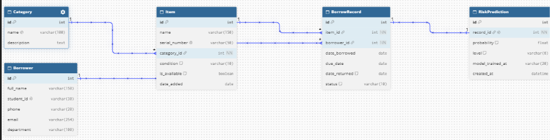

# Lab Equipment Inventory and Borrowing Tracker

A Django web application that records laboratory equipment, tracks who borrows
what, and uses a machine learning model to predict which borrowings are likely
to be returned late. Results appear on an AdminLTE dashboard.

Final Exam project: Web Technologies and API Services.

**Live demo:** https://lab-tracker-mgzo.onrender.com/
**Repository:** https://github.com/sylvieshimwauwase/Lab-equipment-inventory-and-borrowing-tracker.git

## Features

- Three Django apps: `Inventory` (categories, items), `Borrowing` (borrowers, borrow records), `Analytics` (late-return prediction)
- Full CRUD for categories, items and borrowers, with delete confirmation pages
- Borrow and return workflow; availability and overdue status are computed automatically
- Search, filters and pagination on every list
- Login/logout, with Staff (view, add, edit) and Manager (also delete) roles
- AdminLTE dashboard: summary cards, charts, overdue and due-soon tables
- **Machine learning:** a random forest predicts the chance that a borrowing is returned late
  - trained from our own API and synthetic data
  - every new borrowing is scored automatically
  - dashboard shows at-risk borrowings, risk levels, model accuracy and feature importance
  - a Risk Check page and a prediction API for new, unsaved data
- Read-only JSON API plus `POST /api/predict/`
- 38 automated tests
- PostgreSQL on Neon, with credentials kept in `.env`

## Data model



| Relationship | Cardinality |
|---|---|
| Category to Item | one to many |
| Item to BorrowRecord | one to many |
| Borrower to BorrowRecord | one to many |
| Item and Borrower | many to many, through BorrowRecord |
| BorrowRecord to RiskPrediction | one to one |

Foreign keys to items and borrowers use `PROTECT`, so borrowing history is never deleted by accident.

## Machine learning pipeline

| Stage | How |
|---|---|
| 1. Read data from an API | `train_model --source api` reads our own `/api/training-data/` endpoint |
| 2. Train | Random forest (scikit-learn) on borrowing features; synthetic data adds volume while real history is small |
| 3. Deploy in Django | `Analytics/predictor.py` loads the saved model; if it is missing, the app keeps working without scores |
| 4. Predict on new data | A signal scores each new borrowing; `/analytics/risk-check/` and `POST /api/predict/` score unsaved data |

Model inputs: borrowing period, weekday, the borrower's returned borrowings and late rate, how often the item was borrowed, and whether the item is in fair condition.

Part of the training data is synthetic, so predictions are guidance. Retrain as real borrowings are recorded:

```
python manage.py runserver                 # terminal 1
python manage.py train_model --source both --user ADMIN --password PASSWORD   # terminal 2
python manage.py score_records --all
```

## Screenshots

| Dashboard | Risk Check |
|---|---|
|  |  |

| Borrow records | Admin |
|---|---|
|  |  |

## Setup

1. `python -m venv venv`, then activate it
2. `python -m pip install -r requirements.txt`
3. Copy `.env.example` to `.env` and set `SECRET_KEY`, `DEBUG=True` and `DATABASE_URL` (PostgreSQL)
4. `python manage.py migrate`
5. `python manage.py setup_roles`
6. `python manage.py createsuperuser`
7. `python manage.py seed_data` (optional sample data)
8. `python manage.py train_model --source synthetic` (only if `Analytics/ml_model/` is empty)
9. `python manage.py score_records`
10. `python manage.py runserver`

## Roles

| Role | View | Add and edit | Delete |
|---|---|---|---|
| Staff | yes | yes | no |
| Manager | yes | yes | yes |
| Superuser | yes | yes | yes |

## REST API

All endpoints require login.

| URL | Description |
|---|---|
| `/api/items/` | Items (`?q=`, `?category=`, `?available=true`) |
| `/api/items/<id>/` | One item |
| `/api/categories/` | Categories with item counts |
| `/api/borrowers/` | Borrowers |
| `/api/borrow-records/` | Records (`?status=overdue`, `borrowed`, `returned`) |
| `/api/stats/` | Dashboard summary numbers |
| `/api/training-data/` | Training rows for the model (admin only) |
| `POST /api/predict/` | Late-return risk for a new borrowing (nothing is saved) |

## Tests

```
python manage.py test
```

## Project structure

```
Lab_tracker/   settings, root urls, API
Inventory/     categories and items
Borrowing/     borrowers and borrow records
Analytics/     features, predictor, training command, risk check
templates/     base.html and page templates (AdminLTE)
static/        AdminLTE and custom.css
docs/          ER diagram, screenshots, report
```

## Group 5 members

| Name | Student ID |
|---|---|
| SHIMWA UWASE Sylvie | 20251MBI007 |
| ISENGWE Olga | 20251MBI013 | 
| RUKUNDO Patrick | 20251MBI057 | 