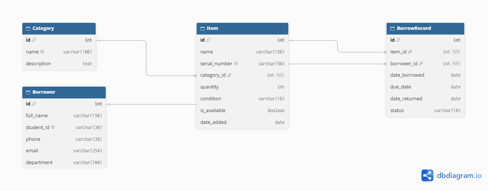

# Lab Equipment Inventory and Borrowing Tracker

A Django web application that records laboratory equipment, tracks who borrows
what, and shows availability and overdue items on an AdminLTE dashboard.

Midterm project: Web Technologies and API Services.

**Live demo:** https://YOUR-APP.onrender.com
**Repository:** https://github.com/YOUR-USERNAME/lab-tracker

## Features

- Two Django apps: `Inventory` (categories, items) and `Borrowing` (borrowers, borrow records)
- Full CRUD for categories, items and borrowers, with delete confirmation pages
- Borrow and return workflow; item availability updates automatically
- Overdue status computed from the due date
- AdminLTE dashboard: summary cards, two charts, overdue and due-soon tables
- Search, filters and pagination on every list
- Login/logout, with **Staff** (view, add, edit) and **Manager** (also delete) roles
- Django admin with inline-friendly lists, filters and a "mark as returned" action
- Read-only JSON API built with Django REST Framework
- 17 automated tests
- MySQL on Aiven, with credentials kept in `.env`

## Data model



| Relationship | Cardinality |
|---|---|
| Category to Item | one to many |
| Item to BorrowRecord | one to many |
| Borrower to BorrowRecord | one to many |
| Item and Borrower | many to many, through BorrowRecord |

All foreign keys use `PROTECT`, so borrowing history is never deleted by accident.

## Screenshots

| Dashboard | Items |
|---|---|
|  |  |

| Borrow records | Admin |
|---|---|
|  |  |

## Setup

1. `python -m venv venv`, then activate it
2. `python -m pip install -r requirements.txt`
3. Copy `.env.example` to `.env` and fill in the database credentials
4. Put the database CA certificate (`ca.pem`) in the project root
5. `python manage.py migrate`
6. `python manage.py setup_roles`
7. `python manage.py createsuperuser`
8. `python manage.py seed_data` (optional sample data)
9. `python manage.py runserver`

## Roles

| Role | View | Add and edit | Delete |
|---|---|---|---|
| Staff | yes | yes | no |
| Manager | yes | yes | yes |
| Superuser | yes | yes | yes |

## REST API

All endpoints are read-only and require login.

| URL | Description |
|---|---|
| `/api/items/` | Items (`?q=`, `?category=`, `?available=true`) |
| `/api/items/<id>/` | One item |
| `/api/categories/` | Categories with item counts |
| `/api/borrowers/` | Borrowers |
| `/api/borrow-records/` | Records (`?status=overdue`, `borrowed`, `returned`) |
| `/api/stats/` | Dashboard summary numbers |

## Tests

```
python manage.py test
```

## Project structure

```
Lab_tracker/   settings, root urls, API
Inventory/     categories and items
Borrowing/     borrowers and borrow records
templates/     base.html and page templates (AdminLTE)
static/        AdminLTE and custom.css
docs/          ER diagram, screenshots, report
```

## Group members
- SHIMWA UWASE Sylvie: 20251MBI007
- ISENGWE Olga: 20251MBI013
- RUKUNDO Patrick: 20251MBI057